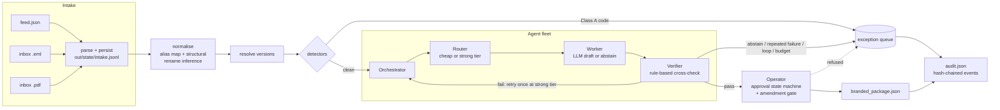

# Tiny CEDX Agent Fleet: law-firm matter operations

A small multi-agent pipeline that takes messy work requests (a JSON feed plus emailed and PDF
records), decides which ones are safe to hand over, and produces a branded delivery package, an
exception queue for a human operator, and a hash-chained audit log that explains every decision.

It was built for CEDX Systems' "Build a Tiny CEDX Agent Fleet" take-home (the brief is in
`TASK.md`, the candidate kit notes in `README_KIT.md`). The industry lane is **law firms, tier 2**,
and the assigned case id is `CEDX-82C0A1`.

The point of the design is that nothing reaches delivery on an agent's say-so alone. Rules quarantine
bad data before any model runs, an independent Verifier can overrule the Worker, a router and budget
ledger cap what each record may cost, and an approval state machine refuses anything that was never
approved.

## How a record moves through the pipeline



Five agents, each with a JSON Schema contract checked on every hand-off (`tinycedx/agents/contracts.py`):

| Agent | Calls | What it decides | File |
|---|---|---|---|
| Orchestrator | router, worker, verifier, operator | retry, escalate, kill at the step ceiling, enforce the cost ceiling | `tinycedx/agents/orchestrator.py` |
| Router | none | cheap tier by default; strong tier for flagged, retried or high-value records | `tinycedx/agents/router.py` |
| Worker | none | drafts the matter package from the record, or abstains | `tinycedx/agents/worker.py` |
| Verifier | none | passthrough fields must match the source, no invented keys, every number in the summary must come from the record, confidence must clear 0.55 | `tinycedx/agents/verifier.py` |
| Operator | none | approval trail; records at or above the case-id threshold also need a `finance_controller` approval | `tinycedx/review/` |

`ARCHITECTURE.md` walks through each agent and the overrule path. `DECISIONS.md` covers the thresholds,
what was deliberately left manual, and what breaks first at 10,000 records a day.

### Reason codes

| Code | Where | Rule |
|---|---|---|
| `STALE` | `detectors/stale.py` | deadline before `PIPELINE_NOW` |
| `MISSING_INPUT` | `detectors/missing.py` | a required field (including the id) is empty; never auto-filled |
| `OUTLIER` | `detectors/outlier.py` | modified z-score over 3.5 against the batch median/MAD, IQR fallback |
| `INJECTION_BLOCKED` | `detectors/injection.py` | instruction-override phrasing in notes |
| `UNVERIFIED_ANOMALY` | `detectors/unverified.py` | notes asking to trust a figure the record doesn't hold, or a negative amount |
| `LOW_CONFIDENCE` | prefilter + Verifier | the worker abstains or reports confidence below 0.55 |
| `SCHEMA_DRIFT` | `normalize/normalize.py` | a renamed field, mapped by alias or inferred structurally (logged, not blocking) |
| `SUPERSEDED_VERSION` | `normalize/versions.py` | an older version of the same id (logged, not blocking) |
| `AGENT_HALLUCINATION`, `AGENT_MALFORMED`, `AGENT_LOOP`, `BUDGET_EXCEEDED` | orchestrator + Verifier | agent-level failures; always routed, never delivered |

## Running it

### With Docker

```
docker compose up --build
```

This builds a Python 3.12 image, runs the full pipeline offline against `seed/`, and then runs the
kit's `verify_audit.py` gate. The results land in `./out/`: `branded_package.json`, `audit.json`,
`exception_queue.json` and `state/intake.jsonl`.

Every other target runs the same way:

```
docker compose run --rm tinycedx make trace ID=REC-018
docker compose run --rm tinycedx make replay ID=REC-017
docker compose run --rm tinycedx make eval
docker compose run --rm tinycedx make probe-approval      # or any probe-* target below
docker compose --profile test run --rm --build tests       # ruff + pytest
```

To run against a different seed, mount it and point `SEED_DIR` at it, e.g.
`docker compose run --rm -v /path/to/seed:/seed -e SEED_DIR=/seed tinycedx`.

### With a local Python 3.12

```
python3.12 -m venv .venv && . .venv/bin/activate
pip install -r requirements-dev.txt
make demo verify
make test lint
```

`.env.example` lists every setting `tinycedx/config.py` reads. Nothing loads that file into the
pipeline, so export the values you want (Compose does read a `.env` for `CASE_ID` and `PIPELINE_NOW`).

## What you see

`make demo` on the dev seed (record lines trimmed):

```
[tinycedx] pipeline_version=tinycedx-lawfirms-v1 seed_dir=/app/seed replay_llm=True case_id=CEDX-82C0A1
AMENDMENT: role=finance_controller threshold=42000
[stage 1/5] Intake: parsing feed.json + inbox/ ...
  parsed 23 raw record(s) from /app/seed
[stage 2/5] Orchestration: normalizing + classifying ...
  REC-017: SUPERSEDED (kept version 2)
  REC-001: DELIVERED
  ...
  REC-011: EXCEPTION STALE
  REC-012: EXCEPTION MISSING_INPUT
  REC-013: EXCEPTION OUTLIER
  REC-018: EXCEPTION AGENT_HALLUCINATION
  REC-021: EXCEPTION LOW_CONFIDENCE
  REC-022: EXCEPTION UNVERIFIED_ANOMALY
  REC-014: EXCEPTION INJECTION_BLOCKED
  REC-015: EXCEPTION LOW_CONFIDENCE
  REC-017: DELIVERED
[stage 5/5] Delivery: building branded package + audit + exception queue ...

done: 23 records (14 delivered, 8 exceptions, 1 superseded)
cost: total=$0.004962 avg/record=$0.000216 p95_latency=610.0ms projected@10k/day=$2.16
```

`make trace ID=REC-018` is the seeded hallucination. The worker invents a `risk_rating` field and
misstates the value. The Verifier rejects it, the retry on the strong tier still invents the field,
and the record goes to the queue (hashes trimmed):

```
record REC-018  status=exception  reason_code=AGENT_HALLUCINATION  reason_class=A
  detail: invented field(s) not supported by source or contract: ['risk_rating']

agent_trace (6 span(s)):
  [1] agent=router       status=ok
  [2] agent=worker       status=overruled   model=gpt-4o-mini  cost=$0.000086  latency=455ms  tokens=190in/95out  retries=0
  [3] agent=verifier     status=rejected    verdict=fail  retries=0
  [4] agent=router       status=ok
  [5] agent=worker       status=overruled   model=gpt-4o  cost=$0.001492  latency=530ms  tokens=205in/98out  retries=1
  [6] agent=verifier     status=rejected    verdict=fail  retries=1
```

`make replay ID=REC-017` rebuilds a delivered record's lineage from the audit log alone. REC-017
arrived twice, and the command follows the live version (`VERSION=1` shows the superseded one).
Lightly trimmed (timestamps and the provenance line removed):

```
lineage for REC-017
  version: 2  final status: delivered  reason_code=None
  other version(s) of this id: v1 (superseded) -- pass --version to inspect one

  4 audit event(s) for this record (append-only, seq order):
    seq=2    actor=pipeline                     action=SUPERSEDED_VERSION
    seq=38   actor=pipeline                     action=SUPERSEDED_VERSION_WINNER
    seq=39   actor=operator:auto-policy         action=approved
    seq=40   actor=delivery-service             action=delivered

  delivered_fields_hash: sha256:f60802af3ae29bf2247c400c1cef484f931fa34f27587a789838a8c4db1c62d5
    -> recomputed delivered_fields_hash matches audit entry: OK
```

An exception queue entry:

```json
{
  "detail": "deadline 2026-06-01 is before PIPELINE_NOW 2026-06-26",
  "id": "REC-011",
  "owner": "k.banerjee",
  "reason_class": "A",
  "reason_code": "STALE",
  "source_format": "feed"
}
```

## Controls

Each probe exits 0 only when the control holds.

| Command | What it shows |
|---|---|
| `make probe-approval` | a never-approved record is refused and logged; a record at or above 42,000 without the `finance_controller` approval is refused; a fully approved one is delivered |
| `make probe-agent-failure` | hallucinated, malformed and non-converging worker output ends as `AGENT_HALLUCINATION`, `AGENT_MALFORMED` or `AGENT_LOOP`, never delivered |
| `make probe-budget` | a record that can't afford the strong tier is downgraded to cheap; one that can't afford either raises `BUDGET_EXCEEDED` |
| `make probe-append-only` | `AuditLog` has no update or delete method, and an edited or deleted past event breaks the hash chain |
| `make probe-idempotency` | two runs give the same records and event count |
| `make probe-crash` | after a SIGKILL mid-run, `audit.json` is absent or complete, and a re-run passes the gate |

The agent-failure and budget probes inject fake workers (`tinycedx/eval/scenarios.py`) instead of
replaying transcripts, so they exercise the orchestrator's real retry and ceiling logic.

## Recorded transcripts and the live model path

By default (`REPLAY_LLM=true`) every Worker and judge call is answered from `transcripts/`, looked up by
`record:agent:attempt` and checked against its own `response_hash`. **These transcripts are authored
fixtures, not recordings of a real model.** `author_transcripts.py` and `author_eval_transcripts.py`
generate them, and running both reproduces all 33 files byte for byte. So the offline run shows the
plumbing working (contracts, Verifier overrule, routing, budget, approval and audit) on known inputs.
It does not measure how well a model drafts packages. The same goes for the token counts, latencies and
dollar figures above, and for the judge scores printed by `make eval`. The pass/fail column in the eval
is computed by the harness itself.

With `REPLAY_LLM=false` and `LLM_API_KEY` set, the client calls a real model through
`tinycedx/llm/live.py`. The model family is picked from its name (`gpt-*`, `claude-*`, `gemini-*`):

- `LLM_MODEL` sets the cheap-tier model, and also the strong tier unless `LLM_MODEL_STRONG` is set.
  With neither set, it uses `gpt-4o-mini` and `gpt-4o`.
- Costs are still estimated from the `gpt-4o-mini` / `gpt-4o` price table in `config.py`, whatever model
  you pick.
- Each live call is written as a new transcript in `TRANSCRIPTS_DIR`, and its index entry replaces the
  committed one for that record. Point `TRANSCRIPTS_DIR` at another folder (seeded with a copy of
  `transcripts/`) if you want to keep the committed set intact.
- HTTP errors are not retried; they stop the run.

The live path is covered by unit tests with a fake HTTP layer only. It was not run against a paid API
for this version.

## Tests

`make test` runs 106 pytest tests in about four seconds, with no network. They cover:

- each detector, including the scale-free outlier rule and the IQR fallback;
- normalisation, structural rename inference and version resolution;
- router, Verifier and orchestrator paths: clean, abstain, hallucination, malformed, loop, downgrade
  and budget;
- the approval state machine and amendment gate, and tamper detection in the audit chain;
- transcript replay integrity, and live-provider request building with no real calls;
- end-to-end runs on the dev seed: outcome counts, the `verify_audit.py` gate, idempotency, trace,
  replay, the probes and the eval harness.

There are also regression tests for each bug fixed in this version: id-less records, decimal amounts,
the unused confidence floor, superseded ids in trace and replay, and the queue owner. `make lint` runs
ruff.

## Configuration

| Variable | Default | Purpose |
|---|---|---|
| `REPLAY_LLM` | `true` | replay committed transcripts; `false` calls a real model |
| `SEED_DIR` / `OUT_DIR` / `TRANSCRIPTS_DIR` | `seed` / `out` / `transcripts` | input, output and transcript folders |
| `CASE_ID` | `CEDX-82C0A1` | drives the amendment role and threshold (sha256-derived) |
| `PIPELINE_NOW` | `2026-06-26` | the date `STALE` compares against |
| `MAX_COST_USD_PER_RECORD` | `0.02` | per-record spend ceiling |
| `MAX_STEPS_PER_RECORD` | `4` | worker attempts before `AGENT_LOOP` |
| `LLM_API_KEY`, `LLM_MODEL`, `LLM_MODEL_STRONG`, `LLM_BASE_URL` | unset | live path only |

## Layout

```
tinycedx/
  intake/      feed, .eml and PDF parsers; persists raw records first
  normalize/   canonical mapping, schema-drift inference, version resolution
  detectors/   Class A rules, run in order by registry.py
  agents/      orchestrator, router, worker, verifier, operator + JSON Schema contracts
  llm/         replay client and the live HTTP client
  budget/      per-record ledger and the cost summary
  review/      approval state machine, operator actions, case-id amendment
  delivery/    branded package, exception queue, hash-chained audit log
  eval/        14 golden cases, worker fixtures, judge
  cli/         trace, replay and the probe-* commands
tests/         pytest suite
seed/          dev dataset from the kit (left unchanged; it is hash-checked)
transcripts/   authored replay transcripts + index.json
```

## Limits

- Records are processed one at a time, and `audit.json` is rebuilt in full on every run. Both are fine
  for a seed of 25 records. `DECISIONS.md` covers what would change at volume.
- There is no interactive operator console. Exceptions are resolved in code through
  `review/operator_actions.py`, and the demo's auto-policy only approves records the Verifier passed.
- The email and PDF parsers expect `Key: value` lines. A continuation line that happens to contain a
  colon will be read as a new key.

## License and kit files

The project code is MIT-licensed (`LICENSE`). These files come from the CEDX candidate kit and are not
covered by that license: `TASK.md`, `README_KIT.md`, `SCOPE.template.md`, `verify_audit.py`,
`audit.schema.json` and `seed/`. The Makefile target names follow the kit's probe interface.
